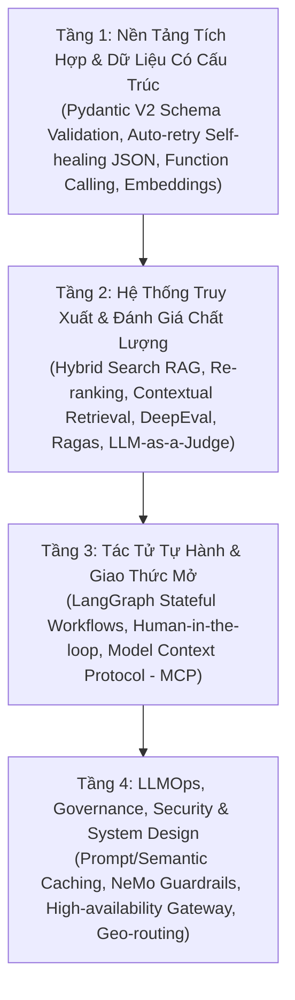

# 🗺️ LỘ TRÌNH ĐÀO TẠO KỸ SƯ AI THỰC CHIẾN (APPLIED AI ROADMAP)

> **Mục tiêu:** Định hình con đường phát triển từ Software Engineer / Data Scientist chuyển hướng sang **Senior / Staff AI Engineer**.

---

## 1. Bản Đồ Năng Lực 4 Tầng (The 4-Layer Competency Stack)

---

## 2. Chi Tiết Lộ Trình 4 Giai Đoạn (12 Tuần Thực Chiến)

### Giai đoạn 1: Foundation & Data Contracts (Tuần 1 - 3)
* **Trọng tâm:** Loại bỏ hoàn toàn lỗi vỡ dữ liệu khi gọi LLM.
* **Kỹ năng cốt lõi:**
  * Pydantic V2 schema enforcement, model validators, custom field sanitizers.
  * Self-healing loop: Biến exception `ValidationError` thành feedback prompt để LLM tự sửa.
  * Quản lý token, streaming chunks và structured streaming.
* **Sản phẩm:** Microservice trích xuất và chuẩn hóa hóa đơn/chứng từ tự động.

### Giai đoạn 2: Advanced Retrieval & Automated Evals (Tuần 4 - 6)
* **Trọng tâm:** Xây dựng hệ thống tri thức chuẩn xác, chống ảo giác (zero-hallucination).
* **Kỹ năng cốt lõi:**
  * Chunking chiến lược: Semantic chunking vs Fixed window.
  * Hybrid search: Kết hợp BM25 (từ khóa chính xác) + Dense Vectors (ngữ nghĩa).
  * Cohere / BGE Re-ranking để tinh chọn top-k ngữ cảnh.
  * Tự động hóa đánh giá bằng Ragas & DeepEval trong CI/CD.
* **Sản phẩm:** Enterprise Knowledge Copilot đa phòng ban có thang đo Faithfulness > 95%.

### Giai đoạn 3: Agentic Workflows & Tool Integration (Tuần 7 - 9)
* **Trọng tâm:** Trao quyền cho LLM tự thực thi và giải quyết bài toán phức tạp.
* **Kỹ năng cốt lõi:**
  * Function Calling đa bước và Text-to-SQL sandbox an toàn.
  * Model Context Protocol (MCP): Viết Server & Client kết nối các công cụ nghiệp vụ.
  * LangGraph: Quản lý trạng thái, branching, cyclical graphs, human-in-the-loop breakpoints.
* **Sản phẩm:** Autonomous Data Analyst Agent tự truy vấn database, vẽ chart và báo cáo qua Slack/Web.

### Giai đoạn 4: Production LLMOps, Cost & Security (Tuần 10 - 12)
* **Trọng tâm:** Đưa hệ thống lên production chịu tải cao, chi phí thấp và an toàn tuyệt đối.
* **Kỹ năng cốt lõi:**
  * Semantic Caching với Redis Vector Search (giảm 80% độ trễ cho câu hỏi lặp lại).
  * Prompt Caching (cắt giảm đến 90% chi phí token).
  * Tracing với Langfuse: Đo lường chi phí từng request, latency p95/p99.
  * Phòng vệ Prompt Injection, Jailbreak và bảo vệ PII với Guardrails.
* **Sản phẩm:** High-Performance AI Gateway chịu tải 10,000 req/min.
