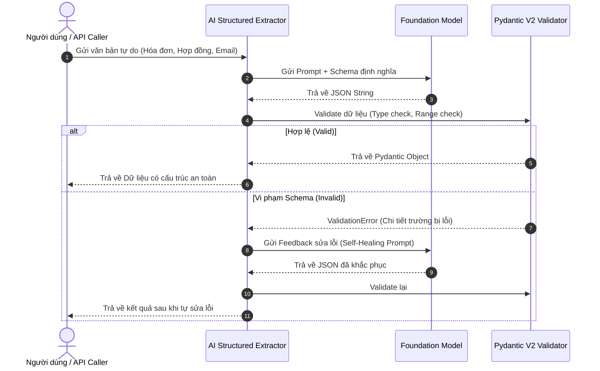

# MODULE 01: NỀN TẢNG KỸ NGHỆ PROMPT & STRUCTURED OUTPUTS

> **Mục tiêu:** Làm chủ kỹ thuật ép kiểu dữ liệu từ LLM ra cấu trúc JSON chuẩn mực với Pydantic V2, loại bỏ 100% rủi ro vỡ định dạng khi tích hợp vào hệ thống Backend.

---

## 1. Bài Toán Doanh Nghiệp Thực Tế

Trong môi trường sản xuất (Production), bạn không thể nhận một đoạn văn bản tự do (unstructured text) từ LLM rồi dùng Regex để bóc tách thông tin. 
* **Rủi ro lớn nhất:** LLM trả về JSON kèm câu dẫn (`"Dưới đây là kết quả của bạn: ```json ..."`), thiếu trường dữ liệu, hoặc sai kiểu dữ liệu (`age: "hai mươi lăm"` thay vì `age: 25`).
* **Hậu quả:** API Backend của bạn bị `500 Internal Server Error`, luồng xử lý tự động bị tắc nghẽn.

**Giải pháp của AI Engineer:**
1. Khai báo Schema chặt chẽ bằng **Pydantic V2**.
2. Sử dụng chế độ **Native Structured Outputs** (`response_format` hoặc `instructor`).
3. Thiết lập cơ chế **Self-Healing Loop (Tự động sửa lỗi)**: Khi schema validation thất bại, gửi lại lỗi chính xác của Pydantic cho LLM để nó tự sửa mà không làm sập ứng dụng.

---

## 2. Kiến Trúc Luồng Xử Lý (Architecture Flow)



---

## 3. Cấu Trúc Mã Nguồn Module 01

- [`schema.py`](schema.py): Định nghĩa các Data Model cho bài toán trích xuất hóa đơn tài chính & phân loại ý định người dùng.
- [`extractor.py`](extractor.py): Lớp `StructuredExtractor` thực hiện gọi model, ép schema và cơ chế Self-Healing.
- [`main.py`](main.py): File thực thi chạy thử nghiệm mẫu với dữ liệu giả lập thực tế.
- [`test_module01.py`](test_module01.py): Bộ kiểm thử tự động `pytest` xác minh toàn bộ luồng.

---

## 4. Hướng Dẫn Chạy & Kiểm Thử

### Chạy trực tiếp demo:
```bash
python -m modules.01_foundations_structured_output.main
```

### Chạy unit test:
```bash
pytest modules/01_foundations_structured_output/test_module01.py -v
```

---

## 5. Thử Thách Thực Hành (Hands-on Challenge)
* **Yêu cầu:** Mở rộng [`schema.py`](schema.py) để thêm trường `tax_code` (Mã số thuế) với ràng buộc Regex: Đúng định dạng 10 hoặc 13 chữ số của Việt Nam.
* Viết thêm 1 test case trong [`test_module01.py`](test_module01.py) để kiểm tra việc validator từ chối mã số thuế không hợp lệ và kích hoạt cơ chế tự sửa lỗi.
