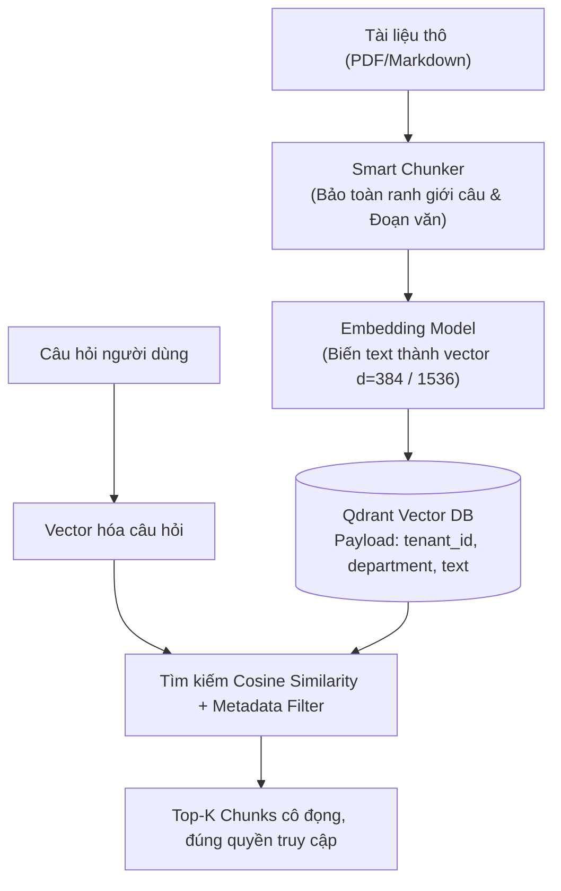

# MODULE 02: EMBEDDINGS & TÌM KIẾM NGỮ NGHĨA (SEMANTIC SEARCH)

> **Mục tiêu:** Làm chủ các chiến lược phân đoạn văn bản (Chunking Strategies), biểu diễn vector ngữ nghĩa, và thiết lập cơ sở dữ liệu vector chuẩn doanh nghiệp với khả năng phân quyền đa khách hàng (Multi-Tenant Isolation).

---

## 1. Bài Toán Doanh Nghiệp Thực Tế

Nhiều dự án AI thất bại ngay từ khâu tìm kiếm dữ liệu (Retrieval) vì 2 sai lầm chết người:
1. **Cắt đoạn mù quáng (Naive Chunking):** Cắt theo số lượng ký tự cố định (ví dụ 500 ký tự) làm đứt gãy câu, mất ngữ cảnh hoặc tách rời điều khoản hợp đồng quan trọng.
2. **Rò rỉ dữ liệu (Cross-Tenant Data Leak):** Tìm kiếm vector trả về tài liệu của công ty khác hoặc phòng ban khác vì không áp dụng bộ lọc siêu dữ liệu (Metadata Filtering) ở tầng index.

**Giải pháp của AI Engineer:**
* Áp dụng **Recursive Character Splitting** và **Sentence-Window Context Chunking** giữ trọn vẹn ngữ nghĩa từng ý.
* Triển khai **Vector Database (Qdrant)** với cơ chế đánh chỉ mục Payload Index phục vụ lọc đa điều kiện (`tenant_id`, `department`, `created_at`) ở tốc độ mili-giây.

---

## 2. Kiến Trúc Luồng Vector Search



---

## 3. Cấu Trúc Mã Nguồn Module 02

- [`chunker.py`](chunker.py): Bộ chia tách văn bản thông minh (Fixed vs Recursive vs Contextual Window).
- [`vector_store.py`](vector_store.py): Wrapper kết nối Qdrant (hỗ trợ cả in-memory `:memory:` cho testing và kết nối Server thật), tích hợp chuẩn hóa L2 và cosine distance.
- [`main.py`](main.py): Demo thực tế lập chỉ mục quy chế công ty và truy vấn có phân quyền.
- [`test_module02.py`](test_module02.py): Bộ kiểm thử tự động kiểm tra tính toàn vẹn của chunk và khả năng cách ly dữ liệu.

---

## 4. Hướng Dẫn Chạy & Kiểm Thử

```bash
# Chạy demo trực tiếp
python -m modules.module02_vector_search.main

# Chạy test suite
pytest modules/module02_vector_search/test_module02.py -v
```
