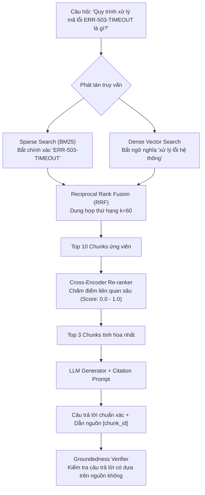

# MODULE 03: HỆ THỐNG RAG DOANH NGHIỆP (PRODUCTION RAG)

> **Mục tiêu:** Xây dựng hệ thống RAG cấp độ sản xuất với tìm kiếm lai **Hybrid Search (BM25 + Dense Vectors)**, thuật toán dung hợp thứ hạng **Reciprocal Rank Fusion (RRF)**, bộ tái xếp hạng **Cross-Encoder Re-ranking**, và cơ chế kiểm định nguồn trích dẫn (**Citation Verification**).

---

## 1. Bài Toán Doanh Nghiệp Thực Tế

Hệ thống RAG cơ bản (chỉ dùng Vector Search) thường gặp 2 thất bại nghiêm trọng:
1. **Thất bại với từ khóa chính xác (Exact Keyword Miss):** Khi người dùng tra cứu mã lỗi (ví dụ: `ERR-503-TIMEOUT`), số hiệu hợp đồng, hoặc mã linh kiện, Vector Embedding làm mờ ký tự chính xác khiến model lấy sai tài liệu.
2. **Ảo giác vì Context loãng (Context Dilution):** Trả về 5 chunks nhưng thông tin quan trọng nằm ở chunk xếp hạng thấp, dẫn đến LLM trả lời phỏng đoán.

**Giải pháp của AI Engineer:**
* **Hybrid Search:** Chạy song song BM25 (bắt chính xác từ khóa) và Dense Vector (bắt ý nghĩa ngữ nghĩa).
* **RRF (Reciprocal Rank Fusion):** Dung hợp thứ hạng 2 bộ tìm kiếm với công thức chuẩn hóa $RRF(d) = \sum \frac{1}{60 + rank(d)}$.
* **Re-ranking:** Đưa top 10 chunks qua mô hình Cross-Encoder để chấm điểm liên quan thực sự trước khi nhồi vào LLM Prompt.
* **Citation Verification:** Bắt buộc LLM dẫn nguồn `[Nguồn: chunk_id]` và kiểm tra đối soát tự động.

---

## 2. Kiến Trúc Luồng Hybrid RAG Pipeline



---

## 3. Cấu Trúc Mã Nguồn Module 03

- [`bm25.py`](bm25.py): Cài đặt thuật toán BM25 Okapi chuẩn mực cho Sparse Retrieval.
- [`hybrid_retriever.py`](hybrid_retriever.py): Bộ kết hợp BM25 + Vector Store qua thuật toán RRF.
- [`reranker.py`](reranker.py): Bộ tái xếp hạng Cross-Encoder tinh chọn các đoạn văn bản giá trị nhất.
- [`rag_pipeline.py`](rag_pipeline.py): Pipeline RAG hoàn chỉnh sinh câu trả lời kèm trích dẫn và kiểm định độ trung thực.
- [`main.py`](main.py): File thực thi chạy thử nghiệm tra cứu sự cố kỹ thuật.
- [`test_module03.py`](test_module03.py): Test suite kiểm thử toàn diện toán học RRF và độ bao phủ tìm kiếm.

---

## 4. Hướng Dẫn Chạy & Kiểm Thử

```bash
# Chạy demo trực tiếp
python -m modules.module03_production_rag.main

# Chạy kiểm thử tự động
pytest modules/module03_production_rag/test_module03.py -v
```
