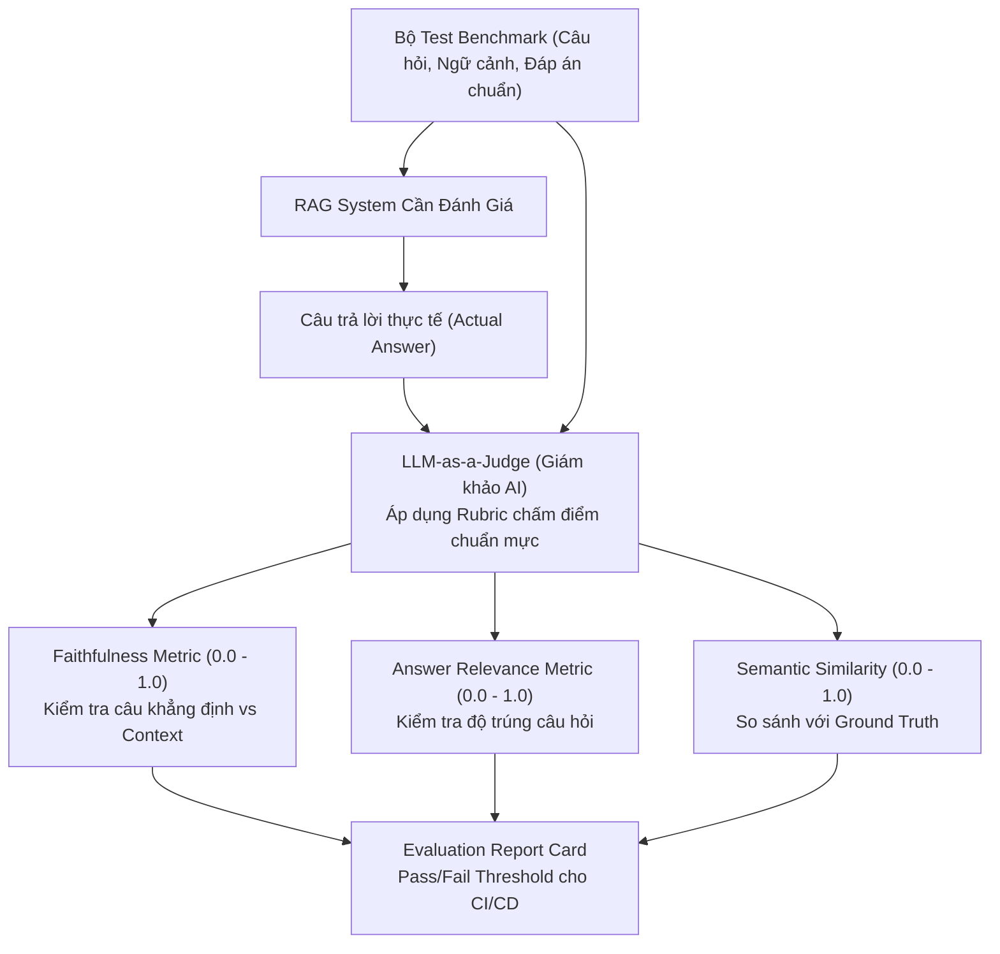

# MODULE 04: BỘ ĐÁNH GIÁ CHẤT LƯỢNG TỰ ĐỘNG (LLM EVALS & BENCHMARKING)

> **Mục tiêu:** Xây dựng khung kiểm thử chất lượng LLM (LLM Evaluation Framework), đo lường độ trung thực (Faithfulness), độ liên quan (Answer Relevance), thiết lập cơ chế **LLM-as-a-Judge** và tạo tập dữ liệu kiểm thử tổng hợp (Synthetic Dataset Generation).

---

## 1. Bài Toán Doanh Nghiệp Thực Tế

Trong phát triển phần mềm truyền thống, bạn có unit test để kiểm tra `1 + 1 == 2`. Nhưng với LLM:
* Đầu ra là ngôn ngữ tự nhiên không xác định (non-deterministic).
* Khi kỹ sư thay đổi Prompt hoặc chuyển từ model này sang model khác, nếu chỉ kiểm tra bằng cảm tính ("Vibe check" - thử gõ vài câu) thì khi đưa lên sản phẩm sẽ xuất hiện thảm họa: **Model bị ảo giác, trả lời lạc đề, hoặc rò rỉ dữ liệu mà không hề hay biết**.

**Giải pháp của AI Engineer:**
* Xây dựng bộ kiểm thử tự động **LLM Evals** tích hợp trực tiếp vào quy trình CI/CD (`pytest`).
* Đo lường 3 chỉ số sống còn:
  1. **Faithfulness (Độ trung thực):** Tỷ lệ các câu khẳng định trong câu trả lời được bảo chứng bởi ngữ cảnh.
  2. **Answer Relevance (Độ liên quan):** Câu trả lời có giải quyết đúng điều người dùng hỏi hay trả lời lan man.
  3. **Context Recall (Độ bao phủ):** Ngữ cảnh truy xuất được có chứa đủ thông tin để trả lời câu hỏi không.
* Áp dụng phương pháp **LLM-as-a-Judge** với thang điểm (Rubric) chi tiết.

---

## 2. Kiến Trúc Luồng Đánh Giá Tự Động (Eval Pipeline)



---

## 3. Cấu Trúc Mã Nguồn Module 04

- [`metrics.py`](metrics.py): Các thuật toán tính điểm Faithfulness, Relevance và Semantic Match.
- [`judge.py`](judge.py): Lớp `LLMJudge` thực hiện vai trò giám khảo với Structured Output.
- [`synthetic_dataset.py`](synthetic_dataset.py): Trình sinh tự động các cặp câu hỏi - câu trả lời giả lập từ văn bản thô.
- [`main.py`](main.py): File thực thi chạy toàn bộ quy trình kiểm thử và in bảng điểm đánh giá.
- [`test_module04.py`](test_module04.py): Bộ kiểm thử `pytest` bảo đảm hệ thống đánh giá hoạt động chuẩn xác.

---

## 4. Hướng Dẫn Chạy & Kiểm Thử

```bash
# Chạy demo trực tiếp
python -m modules.module04_llm_evals.main

# Chạy test suite
pytest modules/module04_llm_evals/test_module04.py -v
```
