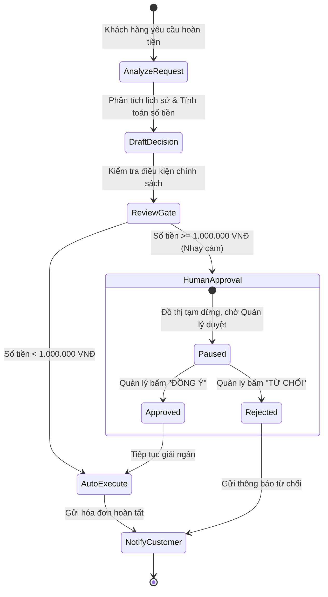

# MODULE 07: KỸ NGHỆ TÁC TỬ TỰ HÀNH & WORKFLOWS (LANGGRAPH & AGENTS)

> **Mục tiêu:** Xây dựng hệ thống tác tử tự hành có trạng thái (**Stateful Agent Workflows**), quản lý chu trình lặp (Cyclical Graph), kiểm soát điểm dừng phê duyệt của con người (**Human-in-the-loop Breakpoints**), và phân bổ nhiệm vụ đa tác tử (**Multi-Agent Collaboration**).

---

## 1. Bài Toán Doanh Nghiệp Thực Tế

Trong các quy trình nghiệp vụ nhạy cảm (Tài chính, Y tế, Pháp lý):
* **Rủi ro tự động hóa 100%:** Bạn không thể để AI tự động chuyển tiền hoàn tiền (Refund) cho khách hàng hoặc gửi email chính thức ra ngoài mà không có sự kiểm duyệt của con người.
* **Hạn chế của chuỗi tuyến tính (Linear Chain):** Chuỗi `Bước 1 -> Bước 2 -> Bước 3` sẽ sụp đổ nếu Bước 2 làm sai và cần lặp lại (Feedback loop).

**Giải pháp của AI Engineer:**
* Xây dựng đồ thị trạng thái **StateGraph** (Mô hình kiến trúc LangGraph).
* Trạng thái (**State**) được lưu vết và bảo toàn qua từng Node.
* **Human-in-the-loop Gate (Cổng phê duyệt):** Khi một hành động vượt ngưỡng rủi ro, đồ thị tự động tạm dừng (Interrupt/Pause), lưu trạng thái vào Checkpointer, chờ con người duyệt (`APPROVED` / `REJECTED`) rồi mới tiếp tục chạy tiếp Node tiếp theo.

---

## 2. Kiến Trúc Luồng Đồ Thị Hoàn Tiền Tự Hành (StateGraph)



---

## 3. Cấu Trúc Mã Nguồn Module 07

- [`state_graph.py`](state_graph.py): Động cơ StateGraph hỗ trợ đồ thị có chu trình, điều kiện rẽ nhánh và điểm ngắt Human-in-the-loop.
- [`workflow.py`](workflow.py): Định nghĩa State và các Node của quy trình hoàn tiền tự hành.
- [`main.py`](main.py): File thực thi minh họa đồ thị tự động dừng chờ phê duyệt và phục hồi tiếp tục chạy.
- [`test_module07.py`](test_module07.py): Test suite kiểm thử toàn diện khả năng rẽ nhánh và cơ chế Checkpointing.

---

## 4. Hướng Dẫn Chạy & Kiểm Thử

```bash
# Chạy demo trực tiếp
python -m modules.module07_agentic_workflows.main

# Chạy test suite
pytest modules/module07_agentic_workflows/test_module07.py -v
```
