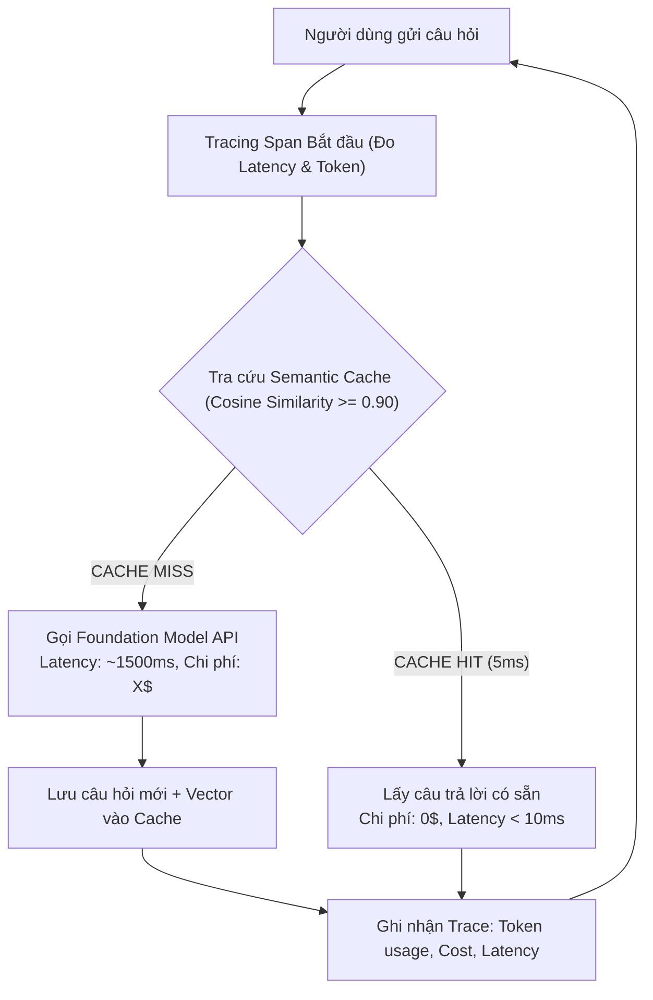

# MODULE 08: LLMOPS, SEMANTIC CACHING & OBSERVABILITY

> **Mục tiêu:** Xây dựng tầng bộ nhớ đệm ngữ nghĩa (**Semantic Cache**) cắt giảm 80% chi phí API và hạ độ trễ từ 3s xuống 5ms; thiết lập hệ thống giám sát phân tán (**Tracing & Cost Tracking**) tương thích chuẩn OpenTelemetry / Langfuse.

---

## 1. Bài Toán Doanh Nghiệp Thực Tế

Trong môi trường vận hành quy mô lớn (High Traffic AI App):
* Hàng nghìn người dùng thường hỏi những câu hỏi có cùng ý nghĩa:
  * Người dùng 1: *"Chính sách bảo hành laptop là bao lâu?"*
  * Người dùng 2: *"Laptop được bảo hành mấy năm thế shop?"*
* **Nếu không có Semantic Cache:** Cả 2 câu hỏi đều phải gọi ra Cloud LLM -> Tốn tiền gấp đôi, người dùng phải chờ 2 - 4 giây.
* **Với Semantic Cache:** Câu hỏi thứ hai được nhận diện tương đồng ngữ nghĩa ($\ge 0.90$) và trả về ngay từ RAM/Redis chỉ trong **5 mili-giây với chi phí 0 VNĐ**.

---

## 2. Kiến Trúc Luồng Semantic Caching & Tracing



---

## 3. Cấu Trúc Mã Nguồn Module 08

- [`semantic_cache.py`](semantic_cache.py): Động cơ bộ nhớ đệm ngữ nghĩa dựa trên vector embedding và ngưỡng cosine threshold.
- [`cost_tracer.py`](cost_tracer.py): Bộ đo lường token, định giá chi phí động (OpenAI/Anthropic/Gemini) và quản lý OpenTelemetry Traces.
- [`main.py`](main.py): File thực thi chạy thực nghiệm so sánh tốc độ và chi phí giữa Cache Miss và Cache Hit.
- [`test_module08.py`](test_module08.py): Test suite kiểm thử độ chuẩn xác của ngưỡng tương đồng và tính toán chi phí.

---

## 4. Hướng Dẫn Chạy & Kiểm Thử

```bash
# Chạy demo trực tiếp
python -m modules.module08_llmops_caching.main

# Chạy test suite
pytest modules/module08_llmops_caching/test_module08.py -v
```
