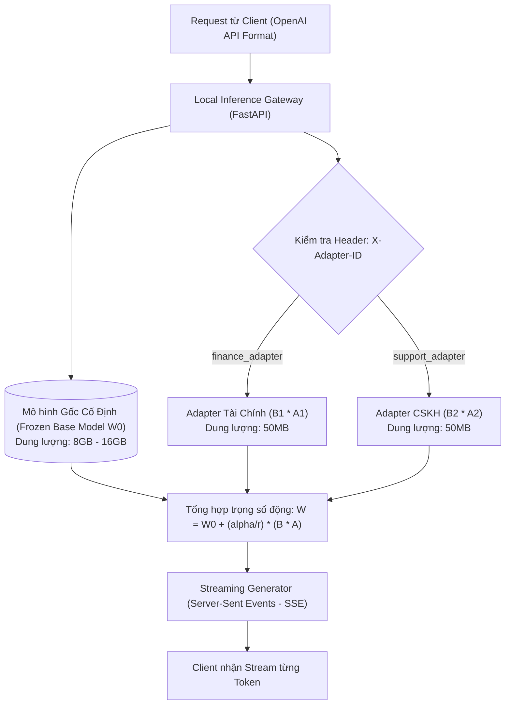

# MODULE 10: PHỤC VỤ CỤC BỘ & TINH CHỈNH THAM SỐ HIỆU QUẢ (LOCAL LLMS & LORA)

> **Mục tiêu:** Xây dựng cổng phục vụ mô hình cục bộ (**OpenAI-Compatible Local Server**) hỗ trợ truyền dữ liệu trực tiếp (**SSE Streaming**); làm chủ nguyên lý tinh chỉnh tham số hiệu quả (**LoRA / QLoRA**) và cơ chế chuyển đổi linh hoạt nhiều Adapter chuyên biệt (**Multi-Adapter Dynamic Switching**).

---

## 1. Bài Toán Doanh Nghiệp Thực Tế

Trong môi trường doanh nghiệp bảo mật cao (Ngân hàng, Y tế, Chính phủ):
1. **Ràng buộc chủ quyền dữ liệu (Data Sovereignty):** Dữ liệu không được phép rời khỏi máy chủ On-premise để gửi lên Cloud.
2. **Bài toán chi phí & Tác vụ chuyên biệt:** Việc gọi các model khổng lồ (GPT-4o, Claude 3.5) cho các tác vụ lặp đi lặp lại (như gán nhãn vé hỗ trợ, trích xuất mã linh kiện) gây lãng phí hàng nghìn USD.
3. **Giải pháp:** Tự chạy mô hình cục bộ (Ollama / vLLM / Local Weights) và tinh chỉnh bộ chuyển đổi siêu nhẹ (**LoRA Adapter**) chỉ vài chục Megabytes cho từng phòng ban.

---

## 2. Kiến Trúc Multi-Adapter LoRA Serving



---

## 3. Cấu Trúc Mã Nguồn Module 10

- [`lora_engine.py`](lora_engine.py): Cài đặt công thức suy luận LoRA $W_0 + \frac{\alpha}{r} (B \cdot A)$, hỗ trợ nạp và hoán đổi Adapter động trong RAM.
- [`local_server.py`](local_server.py): Server API chuẩn OpenAI (`/v1/chat/completions`) viết bằng FastAPI, hỗ trợ SSE Streaming.
- [`main.py`](main.py): File thực thi chạy kiểm nghiệm hoán đổi adapter và streaming token.
- [`test_module10.py`](test_module10.py): Test suite kiểm thử toán học LoRA scaling và tính tương thích API.

---

## 4. Hướng Dẫn Chạy & Kiểm Thử

```bash
# Chạy demo trực tiếp
python -m modules.module10_local_serving_lora.main

# Chạy test suite
pytest modules/module10_local_serving_lora/test_module10.py -v
```
