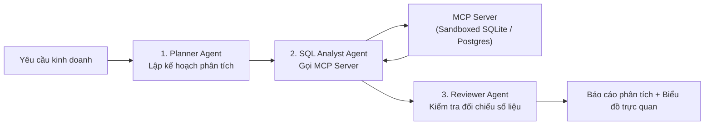

# 🏆 CAPSTONE 2: AUTONOMOUS DATA ANALYST AGENT (WITH MCP)

> **Đội ngũ Agent tự động phân tích dữ liệu kinh doanh, truy vấn cơ sở dữ liệu an toàn trong SQL Sandbox và giao tiếp thông qua giao thức chuẩn công nghiệp Model Context Protocol (MCP).**

---

## 1. Tổng Quan Kiến Trúc Dự Án

Dự án kết hợp tinh hoa từ **Module 05, 06, 07**:
* **Giao Thức MCP Server:** Đóng gói cơ sở dữ liệu phân tích thành một MCP Server chuẩn, cung cấp các công cụ:
  * `query_database_sandbox`: Truy vấn an toàn (chỉ SELECT, có giới hạn dòng).
  * `generate_chart_config`: Sinh cấu hình biểu đồ tương tác (Chart.js / Plotly).
* **LangGraph Multi-Agent Orchestration:**
  * **Planner Agent:** Phân tích câu hỏi người dùng thành các bước logic.
  * **SQL Agent:** Viết và thực thi câu lệnh SQL qua MCP.
  * **Reviewer Agent:** Kiểm tra tính hợp lý của số liệu trước khi tổng hợp báo cáo.
* **Human-in-the-Loop:** Yêu cầu phê duyệt nếu phát hiện hành động có chi phí tính toán cao.

---

## 2. Kiến Trúc Luồng Đa Tác Tử (Multi-Agent Flow)



---

## 3. Hướng Dẫn Khởi Chạy Nhanh

```bash
# Chạy agent phân tích tương tác
python -m projects.capstone2_autonomous_data_agent.run_agent
```
