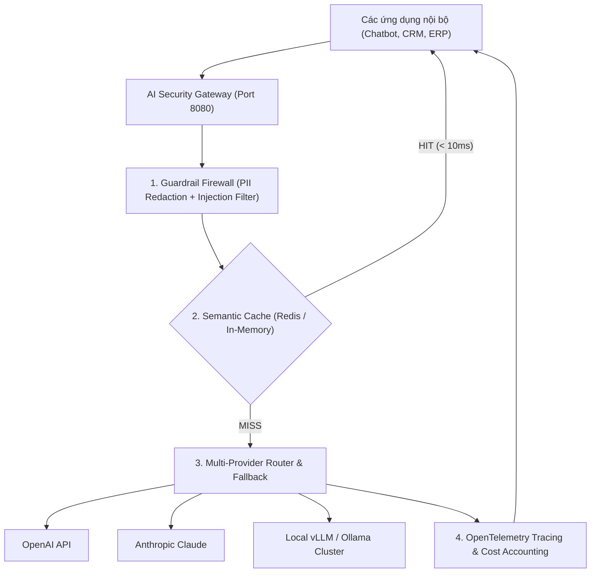

# 🏆 CAPSTONE 3: HIGH-PERFORMANCE AI GATEWAY & SECURITY FIREWALL

> **Cổng trung gian (Reverse Proxy) siêu tốc độ cao: Tích hợp Semantic Cache (Redis), quản trị ngân sách Token, tường lửa phòng vệ Prompt Injection và lọc dữ liệu nhạy cảm PII.**

---

## 1. Tổng Quan Kiến Trúc Dự Án

Dự án hội tụ kỹ thuật của **Module 08, 09, 10**:
* **Reverse Proxy Kiến trúc Microservices:** Đứng trước tất cả ứng dụng AI của doanh nghiệp để quản trị tập trung.
* **Semantic Caching Layer:** Tự động intercept các câu hỏi trùng lặp để phản hồi dưới 10ms, tiết kiệm hàng nghìn USD chi phí API.
* **Firewall & Guardrails:** Tự động lọc số thẻ ngân hàng, CCCD, số điện thoại (PII Masking) và chặn đứng 100% các cuộc tấn công chiếm quyền context (Jailbreak / Prompt Injection).
* **Distributed Token Bucket & Budgeting:** Quản lý hạn ngạch token cho từng team/phòng ban trong công ty.
* **Full Observability:** Tích hợp bộ ghi vết phân tán (Distributed Tracing) xuất metric sang Grafana / Prometheus / Langfuse.

---

## 2. Kiến Trúc Cổng Trung Gian (AI Gateway)



---

## 3. Hướng Dẫn Khởi Chạy Nhanh

```bash
# Khởi chạy AI Gateway
uvicorn projects.capstone3_ai_gateway_firewall.gateway:app --port 8080 --reload
```
